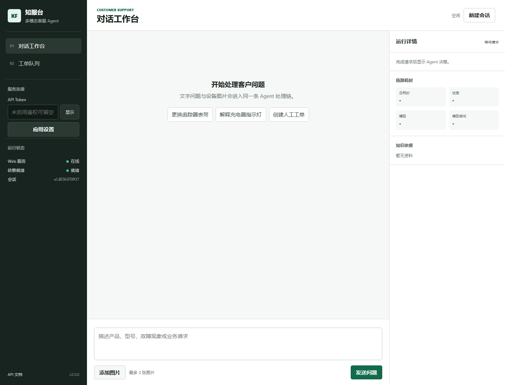
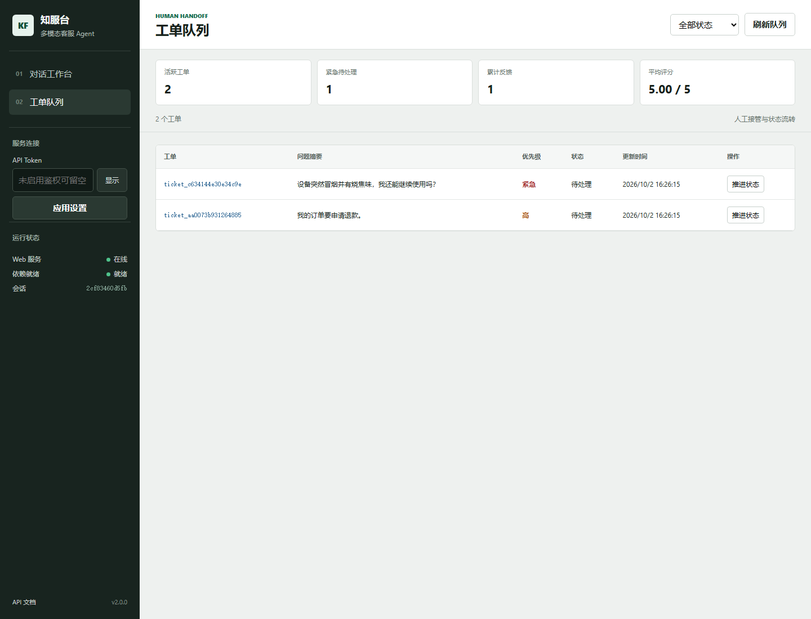

# 多模态客服 Agent

一个可运行、可评测、可部署的中文多模态客服系统。服务接收文字和设备图片，先完成 Agent 路由（规则 / 大模型 / 混合三档可配），再使用产品手册知识库进行混合检索与视觉增强回答；对于安全风险、业务操作、用户明确要求人工或证据不足的请求，自动创建人工工单。

当前版本：`3.0.0`

[](https://github.com/Yyitan/multimodal-customer-agent/actions/workflows/ci.yml)

## 演示

| 对话工作台 | 工单队列 |
| --- | --- |
|  |  |

## 项目定位

这不是只调用一次大模型的问答 Demo。项目覆盖了客服 Agent 的完整业务链：

- 决策：三档可配路由（确定性规则 / 大模型 function-calling / 护栏+大模型混合）、动作选择、证据复核、人工升级、信息不足时主动追问。
- 感知：最多 3 张图片的视觉预分析和产品置信度判断。
- 知识：关键词与向量混合检索、产品别名词典、产品过滤、邻接知识扩展。
- 记忆：SQLite 多轮会话历史，支持服务重启后恢复；可选 LLM 检索改写。
- 工具：人工工单、状态流转、用户反馈和运营汇总。
- 韧性：视觉降级、模型重试、指数退避、熔断和错误分类。
- 工程：API 鉴权、限流、输入校验、版本化接口、SSE 流式响应、Prometheus 指标和审计日志。
- 交付：客服运营工作台、Docker、CI、自动化回归、四层评测、消融实验和性能基线。

## 系统流程

```text
用户文字 / 图片
  -> API 鉴权、限流和输入安全校验
  -> Agent 路由（rules / llm / hybrid 三档）
     -> 安全风险 / 业务操作 / 明确转人工：创建工单
     -> 知识类请求：继续处理（信息严重不足时直接追问）
  -> 读取会话历史（可选：LLM 检索改写）
  -> 视觉预分析（失败时降级为纯文本）
  -> 置信度驱动的产品检索策略
  -> 关键词 + BGE 向量混合检索
  -> 上下文构造和知识图片候选排序
  -> 大模型生成与结构化图片选择
  -> 证据复核（证据不足则转人工）
  -> 保存会话、指标、反馈和工单
```

详细设计见 [架构说明](docs/architecture.md)。

## 数据与质量

- 20 个产品手册知识域，778 条标准化知识记录，512 维 `BAAI/bge-small-zh-v1.5` 向量索引。
- 23 组回归测试模块（pytest 兼容，`pytest -q` 或 `python -m scripts.run_regression` 均可运行）。
- 56 个检索案例（覆盖全部 20 个产品 + 对抗案例），55 通过 + 1 已知排序缺陷（xfail）。
- 59 个 Agent 路由案例（含口语化对抗案例）：规则迭代前真实通过率 45.76%，迭代后 100%。
- 12 个真实模型生成案例，门禁通过率 91.67%（关键词+图片污染判分），LLM-as-judge 与人工标注一致率 100%。
- 检索消融：产品硬过滤把跨产品污染从 32.73% 降到 0，零召回损失、零延迟成本。
- 路由对比（59 案例）：rules 100%（零成本） / llm 89.83% / hybrid 96.61%（LLM 调用减少 58%），hybrid 为生产推荐。
- 真实模型端到端基线（2026-10-02，`glm-4.5-flash` + `qwen3-vl-flash`）：20 请求、并发 2、0% 错误率、P50 4.48 s、P95 6.45 s。

完整口径与失败分析见 [评测说明](docs/evaluation.md)。

## 快速启动

推荐使用 Docker（无需本地 Python 环境）：

```powershell
Copy-Item .env.production.example .env
# 按需替换模型密钥、模型名称和 AGENT_API_TOKEN；默认 mock 模型可零配置体验
docker compose up --build -d
docker compose ps
```

或使用本地 Python 3.12：

```powershell
py -3.12 -m venv .venv
Set-ExecutionPolicy -Scope Process Bypass
.\.venv\Scripts\Activate.ps1
python -m pip install --upgrade pip
python -m pip install -r requirements.txt -r requirements-dev.txt
Copy-Item .env.example .env
python -m uvicorn app.main:app --host 127.0.0.1 --port 8000
```

默认使用 Mock 文本模型，可直接体验本地检索和业务流程。打开：

- 运营工作台：`http://127.0.0.1:8000/`（支持 `?view=tickets` 直达工单队列）
- OpenAPI 文档：`http://127.0.0.1:8000/docs`
- 服务信息：`http://127.0.0.1:8000/v1/info`
- 就绪检查：`http://127.0.0.1:8000/v1/ready`

接入真实模型时，在 `.env` 中配置文本模型和视觉模型的 Provider、Model、Base URL 与 API Key。可选配置：`AGENT_ROUTING_MODE`（rules/llm/hybrid）与 `AGENT_QUERY_REWRITE_ENABLED`（多轮检索改写）。

## 核心接口

所有稳定业务接口使用 `/v1` 前缀：

| 方法 | 路径 | 作用 |
| --- | --- | --- |
| `POST` | `/v1/chat` | 多模态 Agent 对话 |
| `POST` | `/v1/chat/stream` | SSE 流式对话（routing/references/delta/done 事件） |
| `DELETE` | `/v1/sessions/{session_id}` | 清空会话历史 |
| `GET` | `/v1/tickets` | 查询人工工单 |
| `PATCH` | `/v1/tickets/{ticket_id}` | 更新工单状态 |
| `POST` | `/v1/feedback` | 保存用户评分与反馈 |
| `GET` | `/v1/operations/summary` | 获取运营摘要 |
| `GET` | `/v1/metrics` | Prometheus 文本指标 |
| `GET` | `/v1/knowledge-images/{image_id}` | 获取知识库图片 |

请求示例：

```powershell
$headers = @{ Authorization = "Bearer 你的AGENT_API_TOKEN" }
$body = @{
    question = "我的健身追踪器表带应该怎样更换？"
    session_id = "demo-session"
    images = @()
} | ConvertTo-Json

Invoke-RestMethod `
    -Method Post `
    -Uri "http://127.0.0.1:8000/v1/chat" `
    -Headers $headers `
    -ContentType "application/json" `
    -Body $body
```

接口字段、状态码和响应示例见 [API 文档](docs/api.md)。

## 测试与评测

不消耗模型额度的完整回归：

```powershell
pytest -q                           # 或 python -m scripts.run_regression
python -m scripts.evaluate_retrieval
python -m scripts.evaluate_agent
python -m scripts.ablation_retrieval
```

真实模型评测（需在 `.env` 配置模型）：

```powershell
python -m scripts.evaluate_generation      # 生成评测
python -m scripts.judge_generation         # LLM-as-judge 质量评审
python -m scripts.run_regression --live    # 真实视觉链路回归
python -m scripts.compare_routing          # rules/llm/hybrid 路由对比
python -m scripts.evaluate_rewrite         # 多轮检索改写消融
```

对已启动的服务执行并发基线：

```powershell
python -m scripts.benchmark_api `
  --base-url http://127.0.0.1:8000 `
  --requests 20 `
  --concurrency 2 `
  --max-p95-ms 15000
```

报告写入 `artifacts/`，该目录不会提交到 Git。真实模型评测依赖外部供应商额度和稳定性，不放入 CI 阻断链路。

## 部署

容器以非 root 用户运行，`/v1/ready` 作为健康检查，SQLite 运行数据和 Hugging Face 缓存使用命名卷持久化。当前模板固定单 Worker；水平扩容前需要将 SQLite 和进程内限流迁移到共享基础设施。

完整检查清单与公网上线步骤见 [部署说明](docs/deployment.md)。

## 项目结构

```text
app/                    Agent、API、检索、路由、改写、存储、安全与前端
app/web/                客服运营工作台
data/normalized/        标准化手册知识
data/index/             知识快照与向量索引
data/evaluation/        检索、生成、Agent 与多轮改写评测集
scripts/                数据处理、测试、评测、消融和性能基线
docs/                   架构、API、部署、评测与简历讲解
test_scripts.py         pytest 入口（包装全部测试模块）
```

## 文档导航

- [架构说明](docs/architecture.md)
- [API 文档](docs/api.md)
- [部署说明](docs/deployment.md)
- [评测说明](docs/evaluation.md)
- [简历与面试复盘指南](docs/resume-guide.md)
- [版本变更记录](CHANGELOG.md)

## 已知边界

- 当前限流器位于进程内，SQLite 也按单实例设计，因此生产模板固定单 Worker。
- SSE 流式为阶段级（答案按句推送），token 级流式需要重构生成层 JSON 输出契约。
- 真实模型质量与延迟受供应商、模型版本和额度影响，需要在目标环境重新运行生成评测和压测。
- 工单系统是本项目内置闭环，真实企业接入时可替换为 CRM、Zendesk 或内部售后系统适配器。
- 规则路由的评测分数包含对同一评测集的调优成分；公平的域外对比需要保留集（held-out），已列入架构扩展点。
