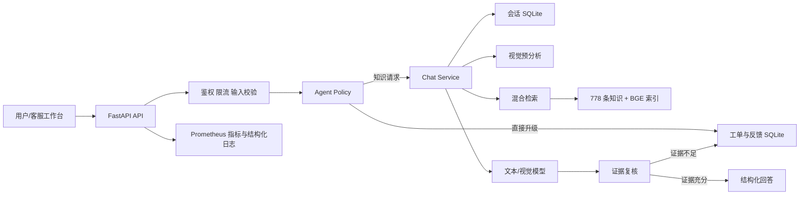

# 架构说明

## 设计目标

系统的核心目标是“有依据地自动解决知识类问题，并在不适合自动处理时可靠地交给人工”。因此架构把大模型放在受约束的执行链中，而不是让模型独自决定所有行为。

## 组件视图

## 模块职责

| 模块 | 责任 |
| --- | --- |
| `app/main.py` | HTTP 路由、请求模型、中间件、鉴权、限流、日志和响应组装 |
| `app/agent_policy.py` | 请求分类、动作选择、证据复核与人工升级策略 |
| `app/services/chat_service.py` | 会话、视觉、检索、Prompt、模型和输出的主编排 |
| `app/vision_analyzer.py` | 提取产品提示、置信度、关键词和可见内容 |
| `app/hybrid_retriever.py` | 合并关键词与向量结果，执行产品策略和邻接扩展 |
| `app/context_builder.py` | 控制上下文预算，排序知识块与图片候选 |
| `app/llm_client.py` | 模型供应商适配、结构化解析、回答清洗 |
| `app/model_resilience.py` | 错误分类、重试、退避和熔断 |
| `app/conversation_store.py` | SQLite 会话持久化、历史截断和会话淘汰 |
| `app/support_store.py` | 工单、反馈和运营统计持久化 |
| `app/observability.py` | Prometheus 格式 Counter、Gauge 与时延统计 |
| `app/input_security.py` | 请求体、Data URL、MIME、图片大小与像素校验 |
| `app/request_control.py` | 请求 ID、滑动窗口限流和调用方键生成 |
| `app/web/` | 对话、Agent 决策、知识依据、反馈和工单工作台 |

## 请求生命周期

1. `RequestBodyLimitMiddleware` 在 JSON 解析前限制请求体，防止超大 Base64 请求耗尽内存。
2. `RequestIdMiddleware` 接收合法调用方请求 ID 或生成新的 ID，并写回响应头。
3. Bearer Token 和滑动窗口限流完成调用方控制。
4. Pydantic 与图片安全模块验证问题、会话 ID、图片数量、真实格式、单图大小、总大小和像素数量。
5. `classify_request` 先做确定性路由：安全、人工、业务操作直接创建工单，知识类问题进入检索链。
6. 服务读取最近会话历史；历史用于理解上下文，但知识事实仍必须来自本轮检索。
7. 有图片时，视觉模型输出产品、置信度、关键词和描述。视觉失败会记录指标并降级为原始文本检索。
8. 产品置信度决定检索策略：
   - `>= 0.8`：产品硬过滤。
   - `>= 0.4` 且 `< 0.8`：目标产品软加权。
   - `< 0.4`：忽略产品提示。
9. 关键词与向量检索按 `chunk_id` 合并，补充同手册邻接知识，并按上下文预算截断。
10. 模型生成回答并从候选中选择知识图片。模型内部资料编号和图片 ID 不直接展示给用户。
11. `review_evidence` 检查引用和上下文记录；证据不足时覆盖模型回答并创建人工工单。
12. 会话、指标和审计日志落地，返回答案、Agent 决策、引用、图片和性能指标。

## Agent 决策模型

Agent 使用“前置路由 + 后置证据复核”两阶段设计：

- 前置路由避免把退款、订单、投诉和安全事故交给生成模型随意处理。
- 后置复核避免在知识库没有证据时输出看似合理但无法验证的答案。
- 工单按风险分级：安全风险为 `urgent`，业务操作为 `high`，普通人工请求为 `normal`。
- `request_id` 在工单表中唯一，重试同一请求不会重复创建工单。

当前分类器采用可解释的确定性规则，适合范围明确的客服域。若扩展到大量业务意图，可增加小模型分类器，但仍应保留安全和业务硬规则作为最高优先级护栏。

## 数据与状态

- `data/index/knowledge_records.jsonl`：与向量一一对应的知识快照。
- `data/index/knowledge_embeddings.npy`：归一化 512 维向量。
- `conversations.db`：会话与轮次。
- `support.db`：工单和客户反馈。
- `data/knowledge_images/`：可通过受鉴权 API 返回的知识图片。

SQLite 连接使用 WAL 模式并由进程内锁保护。该设计适合单实例；多实例部署需要共享 PostgreSQL/Redis 或等价基础设施。

## 韧性和失败边界

| 故障 | 行为 |
| --- | --- |
| 视觉模型失败 | 记录错误，使用原始问题继续文字检索 |
| 知识证据不足 | 不信任生成答案，创建人工工单 |
| 模型瞬时错误 | 指数退避后重试 |
| 模型持续错误 | 熔断，恢复窗口后允许探测请求 |
| 模型限流 | 记录分类和尝试次数，向上游返回 503 与可用的 `Retry-After` |
| 数据库或索引不可用 | `/v1/ready` 返回 503 和具体错误 |
| 非法或超大图片 | 在进入业务链前返回 422/413 |

## 可观测性

- 每个响应携带 `X-Request-ID`。
- 结构化日志记录会话、请求、模型、动作、转人工、耗时、Token 和引用数。
- `/v1/metrics` 暴露 HTTP、Agent、模型、视觉降级、工单、反馈和熔断指标。
- 对话响应返回本次请求的检索、模型、视觉和总耗时，便于前端排查。

## 扩展点

- 将 `SupportStore` 替换为企业 CRM/工单适配器。
- 将 SQLite 会话迁移至 PostgreSQL，将限流迁移至 Redis。
- 为 `/v1/chat` 增加 SSE 流式响应。
- 将 Agent 规则分类升级为“硬规则 + 小模型分类”，同时保持安全硬规则优先。
- 增加自动标注和基于用户反馈的离线评测数据生产链。
